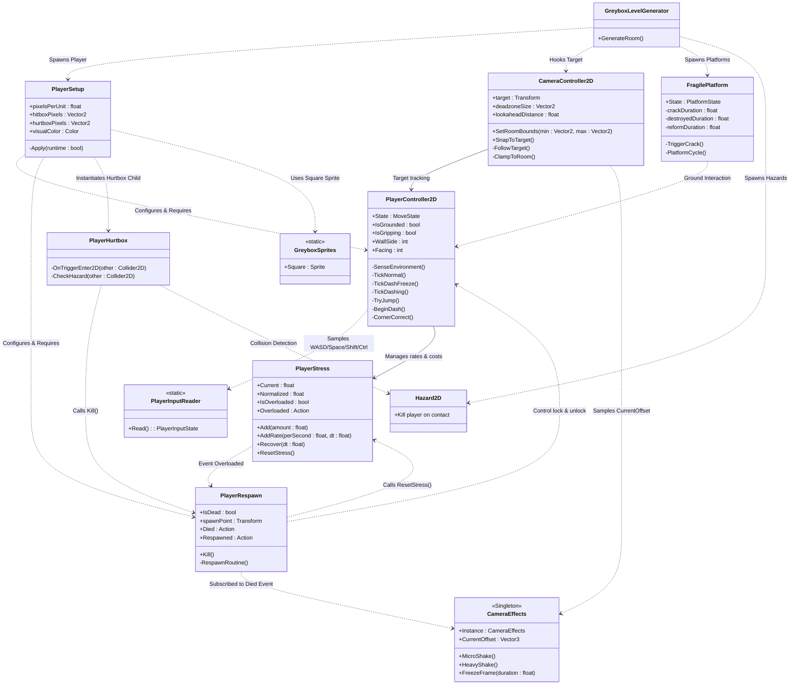

# Architecture Overview (Current Codebase)

ไฟล์นี้สรุปและแสดงโครงสร้างความสัมพันธ์ของคลาสทั้งหมดในโปรเจกต์ปัจจุบัน (`Assets/Scripts/`)

---

## 1. System Interaction & Data Flow (ภาพรวมการไหลของข้อมูลและอีเวนต์)

```mermaid
flowchart TD
    classDef default text-wrap:true,white-space:normal;
    subgraph 1_Input_Subsystem_cd82f7ea[1. Input Subsystem]
        PlayerInputReader_Cr_aa8572f3["PlayerInputReader<br>(Cross-Input API: WASD, Space, Shift, Ctrl)"] -->|Reads Hardware| PlayerInputState_Str_aa59fcd2[/"PlayerInputState (Struct)"/]
    end
    subgraph 4_Camera_Sensory_Fee_07a75429[4. Camera & Sensory Feedback]
        CameraController2D_D_300c78ae["CameraController2D<br>(Deadzone, Lookahead, SmoothDamp)"] -->|Adds Shake Offset| CameraEffects_Shake__02e02b3d["CameraEffects<br>(Shake & Hit-stop / Freeze Frame)"]
    end
    subgraph 3_World_Level_Enviro_ef75e64d[3. World & Level Environment]
        BreakableBarrier_Das_c5639baa["BreakableBarrier<br>(Dash-breakable Wall)"] -.->|implements| interface_IBreakable_2fc150b7[<<interface>><br>IBreakable]
        Hazard2D_Spike_Botto_dc79b0b6["Hazard2D<br>(Spike, Bottomless Pit Trigger)"]
        Room2D_Zone_Trigger__35f02d11["Room2D / Zone Trigger<br>(Room Bounds & Local Checkpoint)"]
        FragilePlatform_Auto_470fb73f["FragilePlatform<br>(Autonomous FSM: Normal -> Crack -> Break -> Reform)"]
    end
    subgraph 2_Player_Subsystem_68c68dec[2. Player Subsystem]
        PlayerSetup_Auto_wir_9c8280b3["PlayerSetup<br>(Auto-wires Rigidbody2D, Hitbox, Visual)"] -->|Creates Child Trigger| PlayerHurtbox_Child__af3e54ce["PlayerHurtbox<br>(Child Trigger Sensor)"]
        PlayerSetup_Auto_wir_9c8280b3 -->|Configures & Requires| PlayerController2D_V_6cdc656b["PlayerController2D<br>(Velocity-driven Physics & FSM)"]
        PlayerHurtbox_Child__af3e54ce -->|Trigger: Contact Hazard| PlayerRespawn_Death__0e3c7711["PlayerRespawn<br>(Death Loop & Checkpoint Teleport)"]
        PlayerRespawn_Death__0e3c7711 -->|Disable / Enable Input & Rigidbody| PlayerController2D_V_6cdc656b
        PlayerController2D_V_6cdc656b -->|Add Stress on Climb/Grip<br>Recover on Ground| PlayerStress_Body_Ov_490b1d1e["PlayerStress<br>(Body Overload Meter 0-100%)"]
        PlayerController2D_V_6cdc656b --> Assists_Logic_Coyote_670b16e4[Assists Logic<br>- CoyoteTimer<br>- JumpBuffer<br>- CornerCorrection]
        subgraph Player_Pure_C_Helper_1c2f234f[Player Pure C# Helpers]
            Assists_Logic_Coyote_670b16e4
        end
    end
    subgraph 5_UI_Dialogue_Subsys_e3f1285a[5. UI & Dialogue Subsystem]
        UIManager_Canvas_Coo_7932e524["UIManager<br>(Canvas Coordinator / Screen Facade)"] --> HUD_Controller_Stres_9d51f4af["HUD_Controller<br>(Stress Bar UI)"]
        UIManager_Canvas_Coo_7932e524 --> Dialogue_UI_Textbox__8b07938d["Dialogue_UI<br>(Textbox & Choices)"]
        NPC_Quest_Interactab_3dfd389a["NPC_Quest<br>(Interactable Trigger)"]
    end
    subgraph 6_Core_Managers_Audi_b42c6dc9[6. Core Managers & Audio]
        SoundManager_Singlet_4e7a528e["SoundManager (Singleton)<br>(Audio Listener & Mixer Volumes)"]
        GameManager_Singleto_f95141c2["GameManager (Singleton)<br>(GameState: Playing / Paused, Scene Loading)"]
    end
    FragilePlatform_Auto_470fb73f -.->|Event: Cracking / Broke| SoundManager_Singlet_4e7a528e
    Dialogue_UI_Textbox__8b07938d -.->|Event: CharacterTyped| SoundManager_Singlet_4e7a528e
    PlayerInputState_Str_aa59fcd2 -.->|Sampled & Buffered| PlayerController2D_V_6cdc656b
    CameraController2D_D_300c78ae -->|Follows Target| PlayerController2D_V_6cdc656b
    PlayerController2D_V_6cdc656b -.->|Event: Jump / Dash / WallSlide| SoundManager_Singlet_4e7a528e
    PlayerStress_Body_Ov_490b1d1e -.->|Event: OnStressChanged / Normalized| HUD_Controller_Stres_9d51f4af
    FragilePlatform_Auto_470fb73f -->|Detects Standing / Gripping| PlayerController2D_V_6cdc656b
    PlayerRespawn_Death__0e3c7711 -.->|Event: Died / Respawned| SoundManager_Singlet_4e7a528e
    Room2D_Zone_Trigger__35f02d11 -.->|Updates Active SpawnPoint| PlayerRespawn_Death__0e3c7711
classDef style0 stroke:oklch(74% 0.024853 248),fill:#e1e5ec,color:oklch(33% 0.029558 248)
class 1_Input_Subsystem_cd82f7ea,2_Player_Subsystem_68c68dec,3_World_Level_Enviro_ef75e64d,4_Camera_Sensory_Fee_07a75429,5_UI_Dialogue_Subsys_e3f1285a,6_Core_Managers_Audi_b42c6dc9,Player_Pure_C_Helper_1c2f234f style0
classDef style1 stroke:oklch(57% 0.220195 280),fill:#e0defd,color:oklch(33% 0.029558 248)
class BreakableBarrier_Das_c5639baa,FragilePlatform_Auto_470fb73f,Hazard2D_Spike_Botto_dc79b0b6,Room2D_Zone_Trigger__35f02d11,interface_IBreakable_2fc150b7 style1
style CameraController2D_D_300c78ae stroke:oklch(52% 0.092082 184),fill:#cce4e2,color:oklch(33% 0.029558 248)
style CameraEffects_Shake__02e02b3d stroke:oklch(52% 0.092082 184),fill:#cce4e2,color:oklch(33% 0.029558 248)
classDef style2 stroke:oklch(62% 0.028346 248),fill:#ced8e0,color:oklch(33% 0.029558 248)
class GameManager_Singleto_f95141c2,PlayerInputReader_Cr_aa8572f3,PlayerInputState_Str_aa59fcd2,SoundManager_Singlet_4e7a528e style2
classDef style3 stroke:oklch(61% 0.148288 249),fill:#d4e7f7,color:oklch(33% 0.029558 248)
class Assists_Logic_Coyote_670b16e4,PlayerController2D_V_6cdc656b,PlayerHurtbox_Child__af3e54ce,PlayerRespawn_Death__0e3c7711,PlayerSetup_Auto_wir_9c8280b3,PlayerStress_Body_Ov_490b1d1e style3
classDef style4 stroke:oklch(71% 0.149045 53),fill:#fae6d8,color:oklch(33% 0.029558 248)
class Dialogue_UI_Textbox__8b07938d,HUD_Controller_Stres_9d51f4af,NPC_Quest_Interactab_3dfd389a,UIManager_Canvas_Coo_7932e524 style4
linkStyle 0,1,3,4,5,6,7,8,9,10,14,17 stroke:oklch(62% 0.028346 248)
linkStyle 2,11,12,13,15,16,18,19 stroke:oklch(62% 0.028346 248),stroke-dasharray:5 5
```

---

## 2. Class Diagram (ความสัมพันธ์เชิงคลาสและเมธอด)


